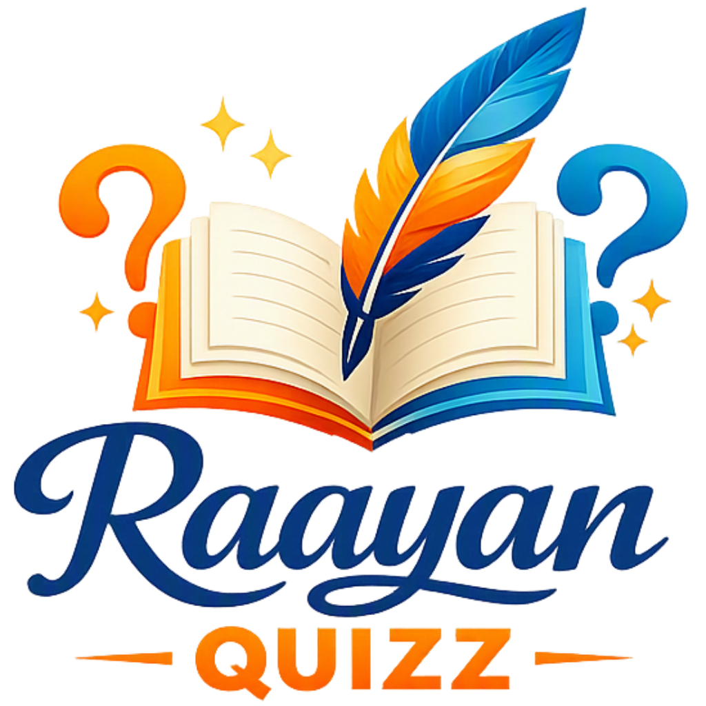

<p align="center">
  
</p>

# Raayan Quizz

Raayan Quizz is a playful, mobile-friendly, offline-capable quiz web app built with plain HTML, CSS, and JavaScript.

No build step. No frontend framework. No runtime dependencies.

Drop in quiz JSON files and the app renders a complete quiz experience with category browsing, setup controls, explanations, history, awards, and progress tracking.

## Highlights

- Offline-friendly single-page app (installable PWA; works offline for anything opened)
- Demo, Grade and board shelves (Grade 4 · **NCERT Grade 8**); each kid picks **which shelves they see** (multi-select in the buddy dialog — filters library, books, awards and stickers)
- **Flipbook reader** for every chapter: two-page curl on desktop, **full-screen single page with swipe** on phones/tablets, pinch/double-tap zoom, thumbnails, read-aloud, “Quiz me on this page”
- **Add your own** (📂 Load): download a sample quiz JSON / schema, upload a quiz (kept in *My Quizzes*), or upload **any PDF** to read in the app — all stored in the browser (IndexedDB), nothing leaves the device
- Buddy avatar, 5 themes, XP levels, daily streak + goal ring, sticker mystery boxes
- **Pause / resume** for “All questions” quizzes — continue from the same question later
- **Mistake bank** with spaced repetition, ⚡ 60-second Challenge mode
- Parent view (long-press the logo): per-subject accuracy, time, weak spots, export/import progress
- Trophy Room with unlockable stamps/awards
- Hindi/Kannada quiz UI strings; image questions supported
- Answers are audited so they can't be guessed by option length or “always True”

## Books in the reader

- `books/` — NCERT page images (public).
- `books-private/` — Lighthouse school books (gitignored; shown only when you serve the app locally).
- Both are generated by `lighthouse/export_books.py` (1000 px WebP pages + thumbnails + per-book `book.json` with page text for read-aloud).
  Adding a grade/board/subject = drop PDFs under `lighthouse/ncert/<grade>/<Subject>/chNN.pdf` (or add a source in that script) and re-run; the UI discovers everything from `books/index.json`.
- About page with logo and version display
- Local file upload for ad-hoc quiz JSON
- Works well on mobile layouts

## Play and See
### [Raayan Quizz](https://raayancoding.github.io/raayan-quizz/)

---

## Core quiz features

- Question types:
  - single
  - multiple
  - boolean
- Setup controls:
  - number of questions
  - difficulty filter (simple, tough, tricky)
  - topic filter
  - shuffle questions/options
  - optional timer
  - instant explanation toggle
- Runtime:
  - progress bar
  - score pill
  - mascot feedback
  - confetti + sounds
- Results:
  - score and percentage
  - message and badge
  - full answer review
  - per-quiz attempt history

## Pause and resume

When a quiz is started with **All** questions, a **Pause** button appears. Progress is also
autosaved after every checked answer and when the tab is closed. The quiz tile shows a
“⏸ paused” tag and the Setup page offers **Continue** / **Start over**. Finishing or
starting a fresh run clears the paused state. Storage key:

```text
raayan-quizz:paused:<quizId>
```

## Awards and progress system

The Trophy Room tracks user progress in local storage and unlocks stamps by milestones.

Examples:

- First quiz finished
- 10, 50, 100, 500, 1000 correct answers
- Perfect scores
- Multiple subjects explored
- Subject completion
- Grade completion

## Mobile friendliness

The UI includes responsive behavior for smaller screens

## Notes

- This app is intentionally generic; it is not hardcoded to one subject.
- We will be adding more subject/topics, email me i can add more if you provide me json
